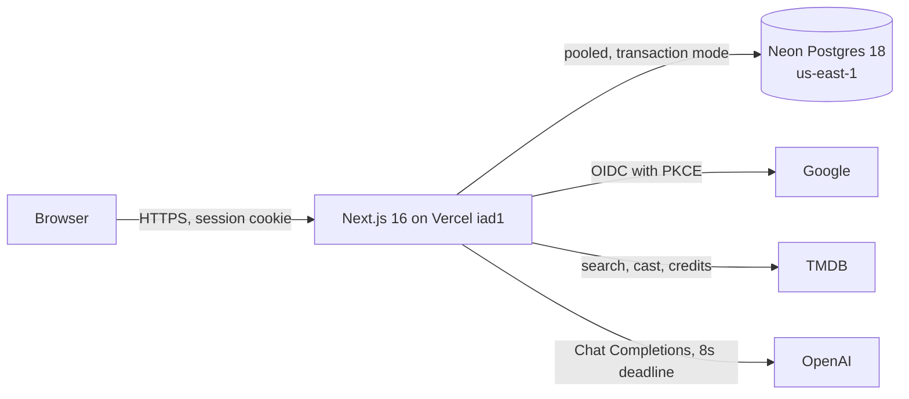
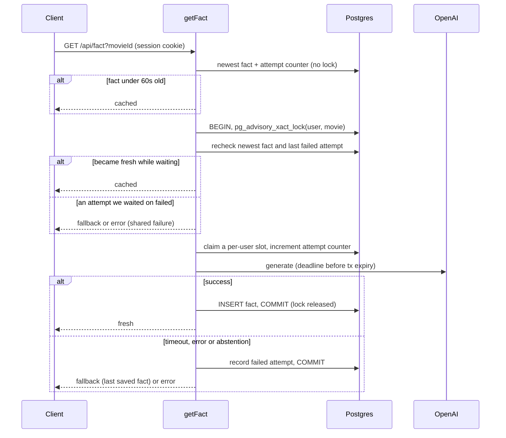
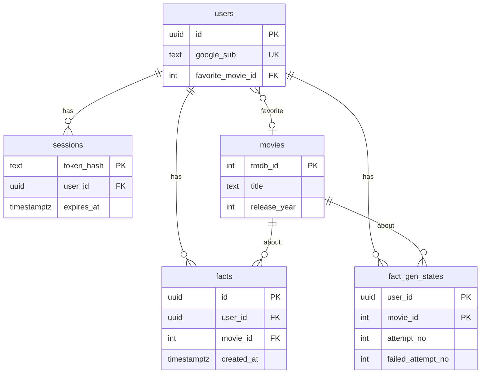

# Movie Mentat

Check it out at https://movie-mentat.vercel.app !

Many times when I watch a movie, I am so amazed by the experience that I do not wish for it to end. And that means I try to investigate all the other movies the cast in that movie has done. This usually leads me into a jagged path of discovery of other great films.

This tool aims to simply that jagged path by modeling the problem as a graph! 
It saves your favorite movie, shows you a short spoiler-free fact about it, and lets you explore other films through their lead actors.

The planning documents are part of the submission. [`PRODUCT_DECISIONS.md`](PRODUCT_DECISIONS.md) describes how the app should behave, [`PLAN.md`](PLAN.md) records every design decision with the options that were considered, [`spec/`](spec/README.md) holds the TLA+ model of fact generation, and [`AI_USAGE.md`](AI_USAGE.md) logs how AI was used at each step.

## Invariants

The hardest part of the exercise is Variant A's fact endpoint. Several requests for the same user and movie can arrive at once, on different serverless instances, while an OpenAI call that might fail or hang is in progress. Before any of that code existed, I wrote down what must always be true in product terms (the invariant table in `PRODUCT_DECISIONS.md`, worked out in a planning session with Codex). Each invariant became a property in a TLA+ model, and each property has a test that runs against real Postgres in [`src/server/facts/service.test.ts`](src/server/facts/service.test.ts).

| Property | What the user sees | How the code enforces it |
|---|---|---|
| S1 | You only ever see your own facts, for the movie you asked about. | Every query takes the user ID from an `AuthedUser`, a type that only the session code can construct. |
| S2 | Simultaneous requests make one OpenAI call. | A `pg_advisory_xact_lock` per (user, movie) is held until commit. The OpenAI call has a deadline that ends before the transaction can expire. |
| S3 | A fact is replaced only once it's at least 60 seconds old. | Freshness is checked again after taking the lock, using `clock_timestamp()`. With `now()`, the time spent waiting for the lock wouldn't count. |
| S4″ | Requests that waited on an attempt get its outcome and don't start their own. | A request reads the attempt counter before it waits. A failed attempt records its number and commits before the lock is released. |
| S5 | A failed attempt never resets the 60-second window. | There's no `lastSuccessAt` column. Freshness is the newest saved fact's `created_at`, and a failure saves no fact. |
| S6 | When generation fails, you see the last saved fact with a notice, or a retryable error if there isn't one. | Every failure path returns through one function that looks up the latest saved fact for that user and movie. |
| S7 | A deliberate retry after a failure starts right away. | A request shares a failure only if the failed attempt's number is higher than the one it saw on arrival. |
| L1 | Every request gets a response. | The service enforces its own 8s deadline on the OpenAI call, Postgres `lock_timeout` is 10s, and the transaction times out at 20s. |

### What the model found

TLC explored every interleaving of 3 requests across 2 users and 2 movies, including crashes, rollbacks and timeouts. The first version of the design failed, and four findings changed it:

- F1: The original design decided whether a waiting request should share a failure by comparing timestamps (`failedAt > startedAt`). TLC found a run where the two timestamps tie, so the waiter started a second attempt. Attempts are now numbered by a per-(user, movie) counter, which can't tie.
- F2: If the request holding the lock crashes or rolls back, it commits nothing, so there's no outcome for the waiters to share. S4 was narrowed to committed outcomes (S4′).
- F3: A request that gives up at `lock_timeout` never saw the attempt it was waiting on. It's exempt from S4 and returns the saved fact or an error, which S6 still governs.
- F4: A Codex review of the code against the model found a fourth way to give up: Prisma's connection-pool timeout can fire before a request reaches the lock. Adding it to the model reproduced the violation, and it got the same exemption as F3 (S4″).

The final design passes every property over 13.3 million distinct states. To show the properties aren't vacuous, the model was broken ten ways (no lock, no recheck, `<=` for `<`, `now()` for `clock_timestamp()`, a leaked lock, and others), and each break violates at least one property. Nine of the same bugs were then made in the TypeScript, and a test fails for each one. [`spec/README.md`](spec/README.md) has the full results and lists what the model leaves out (Prisma, HTTP and isolation levels), which is the gap the Postgres tests cover.

## Architecture

### Components



The app is a single Next.js project. Pages are rendered on the server from the session, and after the first paint the client calls a small JSON API under `/api`. Every third-party call happens on the server, so the Google, TMDB and OpenAI credentials never reach the browser. Postgres is the only state that serverless instances share, which is why the coordination for fact generation lives there too.

| Route | Purpose |
|---|---|
| `GET /api/auth/login`, `GET /api/auth/callback/google`, `POST /api/auth/logout` | Google sign-in and sign-out |
| `GET /api/me`, `PUT /api/me/movie` | Profile and favorite movie |
| `GET /api/fact?movieId=` | The fact for one movie, for the signed-in user |
| `GET /api/movies/search`, `GET /api/movies/[id]/cast`, `GET /api/people/[id]/films` | TMDB catalog, used by search and the graph |

Every error has the shape `{ error: { code, message } }`.

### How a fact request works



The fast path answers most requests without touching the lock. A request that has to wait reads the state again after acquiring the lock, under READ COMMITTED, so it sees whatever the previous holder committed. The OpenAI call runs inside the transaction, which is what makes the lock cover it, and its deadline is the shorter of 8 seconds and the time left before the transaction expires. If the transaction rolls back or the request gives up waiting, the service reads the newest fact once more and returns it as a cache hit if another request has just saved one.

The service returns a sum type, `fresh | cached | fallback | unavailable | no_movie`, and the route maps each case to a response. A fallback carries its failure cause (`timeout`, `abstained`, `shared`, `lock_timeout`, `busy` and so on), so the client can tell a failed refresh apart from an ordinary cache hit.

### Data model



- `movies` is a local snapshot of TMDB entries (ID, title, year, poster). Foreign keys point at it, and a returning user can still see their favorite while TMDB is down. Facts are keyed by TMDB ID, so the 1984 and 2021 *Dune* each have their own history.
- `facts` stores only successful generations, indexed on `(user_id, movie_id, created_at DESC)`. `created_at` defaults to `clock_timestamp()`, so every timestamp comes from one clock.
- `fact_gen_states` holds the coordination state for each (user, movie): the attempt counter and the last failed attempt. It's read only while holding the advisory lock. Hand-written `CHECK` constraints in the init migration make the failure pair all-or-nothing and require a failed attempt to have been started, so those impossible states can't be stored.
- `sessions` stores the SHA-256 hash of the cookie token, never the token, so a database leak doesn't give anyone a live session. Logout deletes the row.

### Trust boundary

Google sign-in uses `openid-client` with PKCE, state and nonce, and verifies the ID token's signature as well as its claims. The session cookie is `httpOnly`, `secure` and `sameSite=lax`, and logout requires an exact `Origin` match.

Inside the server, authorization is enforced by types. Repository functions take an `AuthedUser`, and the only way to get one is from a valid session, so a handler can't pass a user ID that came from the client. IDs are branded (`UserId`, `TmdbId`, `FactId`), so a movie ID can't be passed where a user ID is expected. Request input is parsed into those types at the edge (zod for request bodies, small parsers for query strings), and movie input is trimmed and limited to 1 to 200 characters on the server. Saving a favorite sends only a TMDB ID, which the server fetches again from TMDB, so a client can't store a made-up title.

### Client state (Variant B)

The dashboard is rendered on the server and then managed by pure functions on the client, in the style of the Elm architecture. Inline editing is one reducer in `src/lib/edit-movie.ts` (viewing, editing, saving, and back to editing with the draft and error kept on failure). The fact cache in `src/lib/fact-cache.ts` keeps one entry per movie for 30 seconds, and "New fact" skips it while still respecting the server's 60-second window. A latest-request gate drops responses that arrive after the user has moved to another movie. Each tab refetches `GET /api/me` when it regains focus, and if another tab saved a different favorite, the editor shows that title next to the unsaved draft so the user can choose.

The movie graph follows the same pattern. `src/lib/graph.ts` is a reducer over nodes, edges and expanded directions, and each node's position is computed once when it's added and never changes. GSAP animates only the nodes and edges that changed and turns motion off under `prefers-reduced-motion`.

## How it was built

### Elm-style TypeScript

The rules in `PRODUCT_DECISIONS.md` are written as pure functions and sum types, so they can be tested without a browser or a mock. Outcomes are discriminated unions checked exhaustively with `assertNever`, input is parsed into branded types at the boundary, and impossible states are blocked by both the types and the database constraints. There's no FP library: `Result` is about ten lines.

### Verification

Every push runs typecheck, lint, the tests and a production build in GitHub Actions. The tests run against a real Postgres 18 container, the same version as Neon, and time comes from the database clock with no fake timers. The coverage gate is 90% of lines on `src/server` and `src/lib`, where the core logic lives. Each concurrency bug follows the loop the TLA+ model made possible: a counterexample from TLC becomes a failing test against the real code, then a fix, and the test stays as a regression check. New tests were checked by breaking the code on purpose and confirming a test fails, because a test written by an agent can easily pass no matter what.

Codex reviewed the auth code, the fact service and the Variant B code, read-only, as a second model family. It reported 22 findings. Each one was fixed, except F4, which went back into the model and became an approved exemption. [`AI_USAGE.md`](AI_USAGE.md) lists them.

### Supply chain

AI agents wrote much of this code, so the dependency policy assumes an agent might try to install something it shouldn't. The policy is in [`pnpm-workspace.yaml`](pnpm-workspace.yaml) and `PLAN.md`:

- pnpm is pinned by hash in `packageManager`, all versions are exact, and pnpm refuses any version less than 72 hours old.
- `trustPolicy: no-downgrade` refuses a package whose publishing trust level has dropped, for example from trusted publishing to a plain token.
- Install scripts don't run unless they've been read and allowlisted. Prisma's two scripts were read and left off.
- CI and Vercel install with `--frozen-lockfile`, GitHub Actions are pinned to commit SHAs, and the Postgres image is pinned by digest.
- Subagents can't install packages. Each addition was checked for downloads, transitive dependencies, license, maintainers, deprecation, provenance and install scripts, then recorded in the dependency log in `PLAN.md`.

The policy caught two real problems. The first auth library chosen, Arctic, turned out to be deprecated by its maintainer when pnpm installed it, so it was replaced with `openid-client`, and deprecation was added to the checklist. Later, `trustPolicy` refused the Prisma 7.10 CLI because it was published without provenance (prisma/orm#30850), so Prisma is pinned to 7.9.1. The app has 9 runtime dependencies.

## Which variant and why

Variant A is the submission. Its concurrency and failure handling had the most room for subtle bugs, so it got the formal model and the deepest tests, and it passed its gate (the checks listed in `PRODUCT_DECISIONS.md`) and was deployed before any Variant B work started. Variant B is built on top: the typed API client, inline editing with optimistic updates and rollback, the client fact cache, and cross-tab handling. The movie graph is an extension on top of both, and it reuses the fact service unchanged because facts were already keyed per (user, movie).

## Tradeoffs

| Choice | Cost | Why it was worth it |
|---|---|---|
| A Postgres advisory lock held during the OpenAI call | Each generating request holds a pooled connection for up to about 20 seconds. | One transaction covers the lock, the recheck and the write, so the design is small enough to model and test. A limit of two generations per user keeps a burst of graph clicks from draining the pool. |
| A TLA+ model of the fact service | The model doesn't cover Prisma, HTTP or isolation levels. | It found F1 and F2 before the schema was fixed. The Postgres tests cover the gap the model leaves. |
| `openid-client` and our own session table, over Auth.js | More auth code to own. | Auth.js is in maintenance mode and v5 is still in beta. Owning the session code means it has tests, and sessions are revocable. |
| Hand-written reducers and cache, over React Query | No built-in devtools or retries. | Every rule in the product spec is a pure function with its own test, and there's no new dependency. |
| Refetch on focus for cross-tab changes, over a realtime channel | A tab learns about another tab's save only when the user returns to it. | That's the moment it affects the user, and there's no channel to build or secure. |
| A TMDB match is required to save a movie | Movies TMDB doesn't have can't be saved, and TMDB search has no typo tolerance. | Every favorite has a real identity, so two films with the same title stay separate. |
| Neon's free tier | The first request after an idle period is slow while compute starts. | Free, plain Postgres, with a separate `dev` branch. |
| GSAP for graph motion | It has no provenance attestations and a non-OSI license. | It has no dependencies, and the gap is recorded in the dependency log. |
| Spoiler avoidance through the prompt and model abstention | Facts aren't checked against a source. | Abstention counts as a failure, so a low-confidence fact is never stored. Sources are on the list below. |

Things I chose not to build: an FP library, React Query or SWR, a graph or physics library, a realtime channel, and custom fuzzy search.

## With two more hours

- A source link for each fact, so the user can check it.
- Browser tests for the edit flow and cross-tab conflict, which are tested today as pure functions and by hand.
- A load test of the advisory lock against Neon's transaction-mode pooler, to measure how many simultaneous generations the pool really allows.
- Definitely rate limit on catalog search so we do not irritate our kind friends at TMDB

## Setup

You need Node 24, Docker (or OrbStack) and corepack.

```sh
corepack enable
pnpm install --frozen-lockfile
cp .env.example .env.local   # then fill in the variables below
pnpm db:up                   # Postgres 18 on localhost:5433
pnpm db:migrate              # applies prisma/migrations
pnpm dev
```

### Environment variables

| Variable | Purpose |
|---|---|
| `DATABASE_URL` | Postgres URL the app uses. In production it's Neon's pooled URL. |
| `DIRECT_URL` | Direct Postgres URL, used by migrations. |
| `APP_URL` | The app's origin. It must be https, except on localhost. |
| `GOOGLE_CLIENT_ID`, `GOOGLE_CLIENT_SECRET` | Google OAuth client. The redirect URI is `${APP_URL}/api/auth/callback/google`. |
| `TMDB_READ_TOKEN` | TMDB API read access token. |
| `OPENAI_API_KEY` | OpenAI key. |
| `OPENAI_MODEL` | Optional, defaults to `gpt-4.1-mini`. |

[`ACCOUNT_SETUP.md`](ACCOUNT_SETUP.md) walks through creating the Google, TMDB, OpenAI and Neon accounts.

### Migrations

Migrations are in `prisma/migrations`, and the init migration includes the hand-written `CHECK` constraints. Locally, `pnpm db:migrate` runs `prisma migrate dev`. On Vercel, the build runs `prisma migrate deploy` against `DIRECT_URL` before `next build`. The tests migrate their own database, `movie_mentat_test`, before each run.

### Checks

```sh
pnpm typecheck
pnpm lint
pnpm test:coverage   # needs pnpm db:up
pnpm build
```

## AI usage

- Claude Code was the planning partner and main implementer. It proposed options with a recommendation for each design decision, and I made the call; each decision is recorded in `PLAN.md`.
- A Claude subagent wrote and checked the TLA+ model, and a Sonnet subagent built presentational UI components in an isolated worktree under a brief that banned installs.
- Codex reviewed security- and correctness-critical code read-only, as a different model family.
- The log in [`AI_USAGE.md`](AI_USAGE.md) was kept during the build. It includes what AI got wrong, such as missing Arctic's deprecation and claiming the ID token was verified when only its claims were.
